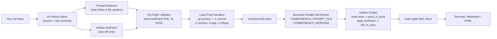

# commitbench

Turn your own git history into a leak-proof benchmark for coding agents, models, and `AGENTS.md` prompts.

Zero runtime dependencies. Zero native addons. Pure Node.js `>=24` (`node:sqlite` WAL run store + `git archive` isolated sandboxes).

## Why commitbench?

Public coding benchmarks tell you how a model performs on popular open-source Python repos. They do not tell you whether a new model, harness flag, or `AGENTS.md` edit actually improves accuracy on **your** codebase, conventions, and real bug fixes.

`commitbench` mines recent bug-fix commits from your repository, strips commit SHAs and file spoilers from the prompt, proves each task is reproducible (`baseSha + hidden testPatch` fails, `fixSha` passes), runs two agent variants A vs B in verified leak-proof sandboxes, and grades them with hidden tests (`fail_to_pass` + `pass_to_pass`).

## Architecture



## Quick Start

Run the built-in self-contained demo (3 realistic bug-fix commits, real pre-flight validation, real leak-proof checks, and A vs B grading in seconds):

```bash
npx commitbench --demo
```

Or inspect structured output:

```bash
npx commitbench --demo --markdown
npx commitbench --demo --json
npx commitbench --demo --html ./work/report.html
```

## CLI Usage

### 1. Mine and validate benchmark tasks from your repo

```bash
npx commitbench mine \
  --repo . \
  --days 45 \
  --limit 15 \
  --validate \
  --cmd "npm test" \
  --out ./work/tasks.json
```

### 2. Run an A/B comparison across any headless agent commands

Every variant command runs inside a fresh leak-proof workspace with two injected environment variables:

- `COMMITBENCH_PROMPT_FILE`: path to the redacted problem statement file (stored outside the workspace).
- `COMMITBENCH_WORKDIR`: path to the isolated workspace root (also set as `cwd`).

```bash
npx commitbench compare \
  --repo . \
  --tasks ./work/tasks.json \
  --a "my-agent --prompt-file \"$COMMITBENCH_PROMPT_FILE\" --model baseline" \
  --b "my-agent --prompt-file \"$COMMITBENCH_PROMPT_FILE\" --model candidate" \
  --label-a "Baseline prompt" \
  --label-b "New AGENTS.md" \
  --cmd "npm test" \
  --concurrency 2 \
  --markdown \
  --html ./work/ab-report.html
```

### All Flags

| Flag | Default | Description |
| --- | --- | --- |
| `--demo` | `false` | Run self-contained demo fixture (3 bug-fix commits, 2 simulated variants) |
| `--repo <path>` | `process.cwd()` | Target git repository |
| `--days <n>` | `45` | Look back N days in git history |
| `--since <expr>` | unset | Explicit `git log --since` expression (overrides `--days`) |
| `--limit <n>` | `15` | Maximum number of tasks to mine |
| `--validate` | `false` | Validate tasks during `mine` (`baseSha + testPatch` fails, `fixSha` passes) |
| `--cmd <testCmd>` | `"npm test"` | Test command used for validation and grading |
| `--out <file>` | unset | Save mined tasks JSON to disk |
| `--tasks <file>` | unset | Load pre-mined tasks JSON for `compare` |
| `--a <cmd>` | required | Headless command for Variant A |
| `--b <cmd>` | required | Headless command for Variant B |
| `--label-a <name>` | `"Variant A"` | Display label for Variant A |
| `--label-b <name>` | `"Variant B"` | Display label for Variant B |
| `--concurrency <n>` | `2` | Bounded parallel worker pool size |
| `--timeout <ms>` | `120000` | Per-task agent timeout with full process-tree termination |
| `--test-timeout <ms>` | `60000` | Per-command test timeout |
| `--db <file>` | `<repo>/.commitbench/runs.sqlite` | SQLite WAL database path |
| `--skip-validate` | `false` | Skip pre-flight validation during `compare` |
| `--markdown` | `false` | Print PR-ready Markdown report |
| `--json` | `false` | Print JSON report |
| `--html <file>` | unset | Write standalone XSS-escaped HTML report |

## Leak-Proof Guarantees

Coding agents with shell access will routinely run `git log --all`, `git show`, `git tag`, or `git reflog` if given a normal checkout. `commitbench` prevents cheating structurally:

1. **Snapshot export via `git archive`**: exports only the exact file tree at `baseSha` (and discards the `pax_global_header` comment block where git embeds commit SHAs).
2. **Fresh single-commit repo**: initializes a clean git repository with one squashed `"Initial commit"`, zero remotes, zero tags, `core.logAllRefUpdates = false`, and deleted `.git/logs`.
3. **Mandatory `verifyZeroGitLeak(workspaceDir, fixSha)`**: runs before every validation and every agent invocation, asserting `git rev-list --all --count === 1`, empty `git remote`, empty `git tag`, absent `.git/logs`, and `git cat-file -e <fixSha>` failure.
4. **Anti-tamper grading**: before evaluating hidden tests, any agent edits to hidden test files are reset via `git checkout HEAD -- <testFiles>`, baseline tests run first (`pass_to_pass`), and then the hidden `testPatch` is applied cleanly (`fail_to_pass`).
5. **Hard timeouts with process-tree cleanup**: kills timed-out child trees using `taskkill /PID <pid> /T /F` on Windows and `-pid` `SIGKILL` on POSIX.

## Honest Comparison

| Capability | commitbench | SWE-bench / Public Evals | Prompt Eval Tools (e.g. promptfoo) | Manual Spot-Checking |
| --- | --- | --- | --- | --- |
| Uses your private repo & real bugs | Yes | No (public repos only) | Requires manual fixtures | Yes |
| Automatic task mining from git history | Yes | No | No | No |
| Leak-proof git isolation (`git archive`) | Yes (verified per run) | Containerized per task | No | Rarely |
| Pre-flight bug reproducibility check | Yes (`base` fails, `fix` passes) | Pre-curated | Manual | Manual |
| Hidden `fail_to_pass` + `pass_to_pass` | Yes | Yes | Custom assertions | Manual |
| Arbitrary CLI coding agent A/B compare | Yes (`--a` / `--b`) | Custom harness setup | LLM API focused | Ad-hoc |
| Runtime dependencies | Zero (Node `>=24` built-ins) | Docker + Python stack | Large npm tree | None |
| Limitations | Requires commits with both source and test diffs; relies on local runtime environment rather than Docker images | High infra cost; benchmark contamination risk | Not a repo-level git sandbox grader | Non-reproducible, biased |

## Programmatic API

```ts
import { mineTasks, compareVariants, formatTerminalReport } from "commitbench";

const tasks = mineTasks({ repoPath: ".", days: 45, limit: 10 });
const report = await compareVariants({
  repoPath: ".",
  tasks,
  variantA: { id: "A", label: "Baseline", command: "node agent-a.mjs" },
  variantB: { id: "B", label: "Candidate", command: "node agent-b.mjs" },
  testCommand: "npm test",
  concurrency: 2,
});

console.log(formatTerminalReport(report));
```

## Development

```bash
npm install
npm run typecheck
npm test
npm pack --dry-run
```

## License

MIT
